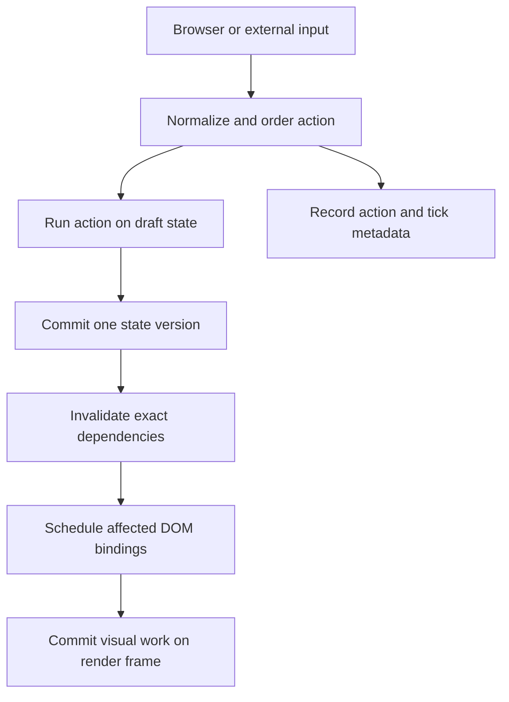

# Product Requirements Document: Deterministic Reactive Frontend Framework

**Status:** Product definition
**Version:** 2.3
**Date:** 2 October 2026
**Working name:** Undecided

## 1. Product overview

Build a standalone JavaScript frontend framework based on a **deterministic reactive runtime** for interactive browser applications whose state and interactions need to be reproducible. Developers define state and named actions, construct views declaratively, and let the runtime track exact dependencies. State changes commit as transactions. The scheduler batches affected DOM bindings onto browser render frames. An optional fixed-timestep mode makes simulation independent of display refresh rate. Recording, replay, history, and inspection expose how an application arrived at a particular state.

The framework itself—its programming model, runtime, APIs, documentation, and measured behavior—is the product. Its individual techniques have precedents; the product explores how they work together as one coherent execution model.

The runtime owns the application lifecycle: developers register views, actions, and handlers, then the framework calls them in response to navigation, inputs, and state changes. Application code uses the public APIs rather than orchestrating DOM updates itself.

### Users and problems

The primary audience is developers of interactive browser applications with complex or frequent state transitions, where reproducibility and inspection matter. The same API must remain comfortable for ordinary interface elements such as forms, lists, and navigation; the product does not position itself as a wholesale replacement for established website frameworks. It addresses unnecessary rendering, inconsistent intermediate states, opaque event-to-state flows, refresh-rate-dependent logic, and failures that are difficult to reproduce. No particular industry-specific latency, safety, or compliance guarantee is assumed.

## 2. Product goals

1. Make typical UI construction concise without a compiler or virtual DOM.
2. Update only bindings affected by a state change and coalesce repeated writes.
3. Give state transitions explicit ordering and all-or-nothing commit behavior.
4. Separate simulation ticks, state commits, and browser render frames.
5. Reproduce supported state transitions from initial state, seed, and recorded inputs.
6. Expose state changes, dependencies, scheduling, and performance to developers.
7. Provide the ordinary framework facilities—events, routing, collections, persistence, and lifecycle cleanup—needed to build complete applications.

**Non-goals:** server-side rendering, hydration, distributed synchronization, and a compiler/JSX transform. Shared state remains an explicitly separate future extension.

## 3. Execution model



**State contract.** Application code reads the latest committed state. A named action executes synchronously against a writable transaction view. Successful completion publishes one state version; an exception leaves committed state unchanged. Subscribers and visual bindings never observe partial changes. Nested dispatches are queued in defined order after the current action. The transaction implementation (copy-on-write, staged operations, or another design) is decided by a measured prototype, not fixed by this PRD. External side effects performed by user code cannot be rolled back.

**Phase 0 architecture decisions.** [ADR 0003](docs/adr/0003-transaction-engine-identity.md) selects copy-on-write as the Phase A implementation basis using corrected, remeasured prototypes; this is not a shipped runtime or a universal performance claim. [ADR 0002](docs/adr/0002-action-schema-serialization.md) defines the initial supported data policy: null/undefined, booleans, strings, finite numbers (including negative zero), same-realm ordinary objects/arrays and null-prototype objects, including array holes and enumerable custom properties. Application state roots are objects/arrays; payloads may be supported primitives. Preserve acyclic aliases and distinct object identity; reject cycles, unsupported prototypes/native values, symbols, accessors and nonenumerable data except array length. Snapshot validation remains separate from application-specific state schemas and final replay checkpoint metadata. [ADR 0004](docs/adr/0004-browser-input-support.md) records proposed browser/input targets and unverified release gates.

**Render contract.** The dependency graph tracks state properties used by computed values and individual DOM bindings. A commit marks affected work dirty. Before an appropriate browser paint, the scheduler evaluates each dirty visual binding from committed state and writes its latest value at most once in that render batch. Render computations cannot mutate state.

**Time contract.** Optional fixed-duration simulation ticks have monotonically increasing IDs. Inputs assigned to a tick are processed in stable recorded order; tick logic operates on a logical clock. The browser can render more or fewer frames than there are ticks. Several ticks can contribute to one visual commit. Visual interpolation between committed ticks is optional and never changes authoritative state.

**Replay contract.** Given the same initial snapshot, action schema/runtime version, seed, and ordered input log—including recorded external results and browser measurements used by actions—the transition engine produces the same committed state at corresponding checkpoints. Browser paint timing and interpolated visuals are not part of this guarantee.

### Illustrative API

These are illustrative design sketches, not implemented public exports. Phase 0 selects element functions with explicit binding tokens; the exact application/action registration surface remains to be integrated in Phase A.

**Candidate A: Native Tagged Template Literals (Evaluated; Public Adoption Deferred)**
```js
import { createApp, html } from 'mini-framework';

const app = createApp({
  target: document.querySelector("#app"),
  initialState: { count: 0 },
  seed: 1234,
  actions: {
    increment(draft) { draft.count += 1; },
    decrement(draft) { draft.count -= 1; }
  },
  view: ({ state, actions }) => html`
    <div class="counter">
      <button @click=${actions.decrement}>-</button>
      <span>Current Count: ${state.count}</span>
      <button @click=${actions.increment}>+</button>
    </div>
  `
});
```

**Candidate B: Ergonomic Element Functions (Selected for Phase A)**
```js
import { createApp, div, button, span } from 'mini-framework';

const app = createApp({
  target: document.querySelector("#app"),
  initialState: { count: 0 },
  actions: {
    increment(draft) { draft.count += 1; },
    decrement(draft) { draft.count -= 1; }
  },
  view: ({ state, bind, actions }) =>
    div({ class: "counter" },
      button({ onClick: actions.decrement }, "-"),
      span("Current Count: ", bind.count),
      button({ onClick: actions.increment }, "+")
    )
});
```

These candidate syntax shapes represent the public ergonomic targets. Both avoid mandatory arrow-function ceremonies for simple properties and boilerplate empty attribute objects. The completed Phase 0 prototype found that arbitrary eager `${state.prop}` interpolations do not retain expression boundaries needed for exact per-binding dependencies. [ADR 0001](docs/adr/0001-view-syntax.md) therefore selects element functions with `bind.prop` tokens and explicit derived bindings, and defers public templates. Token-based templates remain a viable experiment, but no compiler, primitive boxing, or whole-view tracking relaxation is adopted. The exact public API is not frozen, and the original template requirements remain the gate for any later adoption.

## 4. Functional requirements

Every feature in this table belongs to the product. Phases later in the PRD describe build order, not optionality.

| ID        | Feature                              | Required behavior                                                                                                                                                                                                                                                                       | Acceptance criterion                                                                                                                                                                     |
| --------- | ------------------------------------ | --------------------------------------------------------------------------------------------------------------------------------------------------------------------------------------------------------------------------------------------------------------------------------------- | ---------------------------------------------------------------------------------------------------------------------------------------------------------------------------------------- |
| DOM-1     | Declarative DOM abstraction          | Functions create elements, text, attributes, classes, styles, conditional views, and keyed lists.                                                                                                                                                                                       | A form, conditional section, and keyed list can be built and updated solely with public APIs.                                                                                            |
| DOM-2     | Fine-grained DOM updates             | Track each visual binding's dependencies; preserve unaffected nodes and focus.                                                                                                                                                                                                          | Updating one independent property writes only its dependent bindings; stable keyed items keep node identity.                                                                             |
| STATE-1   | Deep reactive store                  | Track nested object reads, writes, property addition/deletion, and structural collection reads. The application store is available to every routed view for the lifetime of the app.                                                                                                    | Changes to unrelated nested properties invalidate different sets of observers; two routes can read and update the same state without losing it during navigation.                        |
| STATE-2   | Reactive collections                 | Track item properties independently from array length/iteration and keyed list structure.                                                                                                                                                                                               | Changing one item's property leaves unrelated item bindings untouched; insertions and reorders remain correct.                                                                           |
| STATE-3   | Derived state                        | Computed values cache results, track dependencies, invalidate lazily, and detect cycles.                                                                                                                                                                                                | Recalculation occurs when a used dependency changes and the value is observed.                                                                                                           |
| ACTION-1  | Transactional named actions          | Action bodies run synchronously against a transaction view; no`async` action or deferred mutation is allowed. Commit once or discard on error; define payloads and nested-dispatch order.                                                                                             | A throwing action changes neither committed state nor UI; a Promise-returning action fails clearly; no observer sees partial state.                                                      |
| SCHED-1   | Frame batching                       | Deduplicate dirty visual work and flush through requestAnimationFrame; expose explicit flush for tests and exceptional cases.                                                                                                                                                           | Repeated changes before a frame cause at most one latest-value write per target.                                                                                                         |
| SCHED-2   | Priority scheduler                   | Immediate input, frame visuals, normal work, and idle work have documented ordering and fairness.                                                                                                                                                                                       | Mixed-priority tests confirm ordering and show normal work is not starved by sustained input.                                                                                            |
| TIME-1    | Fixed simulation ticks               | Configurable tick duration, ordered input queue, pause/resume, and bounded catch-up work.                                                                                                                                                                                               | Identical input logs produce identical tick states under different simulated display rates.                                                                                              |
| TIME-2    | Optional render interpolation        | Expose previous/current committed simulation values and a render-only alpha factor for smooth visual properties. Keep interpolation out of state transitions and replay hashes.                                                                                                         | Visual position can interpolate at different display rates while committed tick hashes remain identical.                                                                                 |
| EVENT-1   | Framework event system               | Register and clean up handlers for clicks, scrolling, keyboard input, and other native events through a public API distinct from calling`addEventListener()` in application code. Delegate bubbling events where suitable and use capture/direct listening when semantics require it. | Click, scroll, and key handlers work through framework APIs; disposed views receive no events; native form/focus behavior remains correct. Internal use of browser listeners is allowed. |
| EVENT-2   | Keyboard and text-input abstraction  | Normalize key-down, key-up, held keys, repeat, paste, input, and composition into recordable semantic inputs. Do not derive entered text solely from keys or force all text updates to wait for compositionend.                                                                         | Key and text-input fixtures, including IME composition and paste, replay to the same committed values without disrupting native editing.                                                 |
| INPUT-1   | External-input adapters              | Browser layout/viewport/scroll measurements, network responses, and other ambient values enter deterministic actions as serialized input payloads. Actions do not read DOM layout or ambient time/random directly.                                                                      | A recorded layout measurement and async response reproduce the same state when the live browser dimensions and network differ.                                                           |
| ROUTE-1   | Reactive router                      | User-triggered navigation changes the URL and reactive route state together; support path/params/query, browser back/forward, not-found view, and route cleanup; document History/hash mode.                                                                                            | A framework-handled click navigates to another view, updates the URL and route state, and preserves app-wide state; direct load and back/forward also produce the expected view.         |
| PERSIST-1 | State locations                      | Explicit memory, session storage, local storage, and URL-backed state with serialization and hydration precedence.                                                                                                                                                                      | Reload retains only configured state; back/forward synchronizes URL state without loops.                                                                                                 |
| RNG-1     | Seeded random and logical time       | Deterministic actions use runtime PRNG and clock rather than ambient random/time sources.                                                                                                                                                                                               | Same seed and inputs yield the same draws and logical timestamps.                                                                                                                        |
| RECORD-1  | Action recording                     | Export initial snapshot/reference, seed, versions, ordered serializable actions and measured/external inputs, with tick IDs where applicable. Use a configurable bounded recent-history buffer, with explicit policy for longer session recording.                                      | Export/import round trip succeeds; retention never leaves actions without a usable baseline snapshot; invalid or incompatible recordings fail clearly.                                   |
| REPLAY-1  | Deterministic replay                 | Re-execute inputs and compare state hashes at checkpoints; report first divergence.                                                                                                                                                                                                     | Recorded checkpoints match under different render schedules.                                                                                                                             |
| HISTORY-1 | Time travel and undo/redo            | Seek prior committed state from periodic keyframe snapshots and replay of subsequent actions; support undo/redo under a documented reversible-action policy.                                                                                                                            | Seeking within the retained window matches recorded state; branching after undo is predictable; expired history is clearly unavailable.                                                  |
| INSPECT-1 | Development inspector                | Show tick/version, action payloads, state changes, dirty dependencies, DOM write count, simulation/render durations, and frame timing.                                                                                                                                                  | A developer can select a transition and identify its inputs and affected bindings.                                                                                                       |
| LIFE-1    | Lifecycle management                 | Dispose handlers, subscriptions, scheduled work, and view/route resources on unmount.                                                                                                                                                                                                   | Repeated mount/unmount does not accumulate listeners or subscriptions.                                                                                                                   |
| DOC-1     | Auditor-ready Markdown documentation | Explain framework features and why DOM updates, actions, routing, and event handling work as designed. Include copyable examples for creating an element, adding attributes, nesting elements, attaching an event, sharing state across routes, and navigating from an action.          | A new user follows the README without source-code archaeology and completes each documented example from the root folder.                                                                |
| PACK-1    | Runnable root folder                 | Provide a documented folder structure, root entry point, package or browser-module configuration, and a single documented command or procedure to run an app from the project root.                                                                                                     | On a clean checkout, an auditor follows root README instructions, starts the app from the root, and imports the framework without moving files or editing internal source.               |
| TECH-1    | Independent implementation           | Implement the framework's DOM abstraction, router, state manager, and event system without using React, Angular, Vue, or another frontend framework/library to supply those features. Tooling for tests or serving files may be used and disclosed.                                     | Dependency and source review shows these four capabilities are implemented by this project rather than delegated to an existing frontend framework.                                      |

### State-engine decision gate

The required contract is atomic publication, exact dependency invalidation, stable keyed identity, and acceptable allocation under frequent updates. Prototype at least (1) a copy-on-write transaction view with structural sharing and change metadata and (2) a staged-operation transaction view with property-level change metadata. Compare rollback correctness, nested objects, arrays/reorders, aliases, garbage collection, memory, and frame-time tails on identical workloads. A patch log may support replay or undo, but JSON paths alone are not stable identities for moved array items. Do not promise “near-zero GC” or select the engine before these results.

### State-location extension

Shared/synchronized state was considered as another location, but distributed ownership and conflict resolution require their own design. It is a future research extension, outside the planned single-runtime replay guarantee. Storage writes run after successful commits; a storage failure is reported and does not undo committed in-memory state.

## 5. Determinism and side effects

For supported state types, the transition function is:

\[S_{n+1} = F(S_n, A_n, T_n, R_n)\]

Here `S` is committed state, `A` the ordered action and payload, `T` logical time, and `R` PRNG state. The recording format includes a format version, application action-schema version, initial snapshot, seed, ordered inputs, and external results. Canonical serialization or an equivalent stable comparison method provides checkpoint hashes.

`Date.now()`, `Math.random()`, network responses, DOM layout queries such as `getBoundingClientRect()`, viewport/scroll measurements, timers, and storage reads do not become deterministic automatically. Action bodies must finish synchronously and may only use their transaction view, serializable payload, and controlled runtime services. They must not query DOM layout, call unrecorded ambient APIs, or start asynchronous mutation. Adapters sample browser/external values outside actions and dispatch them as ordered, serializable inputs. Async effects execute outside actions and dispatch their resolved values as recordable inputs. Replay uses those recorded values rather than rerunning the original external request. The runtime rejects Promise-returning actions and unsupported payload/state types; development diagnostics identify other detectable boundary violations. Arbitrary application code cannot be perfectly prevented from reading global APIs, so the contract must be documented and tested.

**Text input:** Record semantic text changes, including paste and composition, rather than reconstructing text from keydown events. Native input may display an in-progress composition before the corresponding committed application action. The event adapter defines when to dispatch the accepted value and avoids overwriting the browser's active composition. Test the behavior across supported browsers and input methods.

**Bounded history:** By default, retain a configurable maximum of actions and bytes in a circular recent-history buffer. Keep a baseline snapshot for the oldest retained action and periodic keyframe snapshots every configurable number of committed transitions. Eviction advances the baseline and removes older actions/snapshots together; it must never leave an unreplayable action suffix. Seeking starts from the nearest preceding keyframe and replays at most the configured transition interval, plus snapshot restoration cost. A deliberate full-session recording mode has its own memory/export limit and must report when it reaches that limit rather than silently dropping data.

Recordings may contain sensitive application values. Export must be an explicit developer action, and the inspector must show what is included.

## 6. Scheduling details

| Lane      | Work                                                  | Rule                                                            |
| --------- | ----------------------------------------------------- | --------------------------------------------------------------- |
| Immediate | Capture input and process or enqueue its action.      | Stable action order; no promise that DOM is already painted.    |
| Frame     | Evaluate dirty visual bindings and commit DOM writes. | Deduplicate by target within one render batch.                  |
| Normal    | Prompt nonvisual framework work.                      | Must make progress under sustained input.                       |
| Idle      | Persistence and optional diagnostics.                 | May be delayed; core correctness cannot depend on when it runs. |

The fixed-step loop uses an elapsed-time accumulator with a configurable maximum catch-up ticks per display frame. It never silently skips a numbered tick; under overload the simulation may lag. Hidden-tab behavior and explicit pause/resume must be documented and reflected in the time/input contract.

For visual properties that benefit from smoothing, the render scheduler exposes `alpha = accumulator / tickDuration` and the previous/current committed tick values. A binding may derive a display-only interpolated value from them. This is opt-in for position/transform-like visuals; ordinary text and forms use committed values. Interpolation changes neither authoritative state nor replay hashes.

## 7. Developer experience

- Ship an importable browser-native JavaScript package with no mandatory third-party runtime dependencies. Development tools may use dependencies.
- Document a quick start, API reference, execution order, routing, storage locations, deterministic coding rules, lifecycle, recording format, limitations, and version migrations.
- Provide a root README in Markdown with a feature overview, installation/start instructions, a folder map, and copyable examples that create a `div`, nest text and child elements, set an ID/class and other attributes, handle a button click and a scroll event, share state across routed views, and navigate while URL and state change together. Explain the reason for each framework API, not just its syntax.
- Keep an importable public entry point separate from implementation internals. A clean checkout must be runnable from the root using one documented command or a clearly specified browser-module procedure. The auditor must be able to write a small app against public exports without modifying runtime files.
- Provide clear development errors for unknown actions, invalid/nonserializable payloads, state mutation outside an action, computed cycles, render-time mutation, missing list keys, and replay divergence.
- Design action/state payload schemas so TypeScript declarations can infer dispatch names and payload types from the start. Runtime serialization validation remains necessary because types do not validate imported recordings.
- Prototype an optional tagged-template `html` syntax alongside element functions (Task 0.7). Requirements for the tagged-template prototype:
  - **Zero Compilation**: Must run natively in modern browsers via standard `TemplateStringsArray` without Babel, Webpack, or compilers.
  - **Automatic Dependency Tracking**: Eliminate mandatory `${() => state.prop}` arrow wrappers by capturing reactive property accesses during template evaluation.
  - **O(1) Template Caching**: Use a `WeakMap` keyed by `TemplateStringsArray` to cache parsed HTML `<template>` blueprints and native `cloneNode(true)` operations, ensuring zero re-parsing on subsequent renders.
  - **XSS Immunity by Design**: Bind text slots via `Node.data` / `textContent` and attributes via `setAttribute`, strictly preventing unescaped `innerHTML` injection.
  - **Event Delegation Integration**: Parse `@event` directives directly into framework-owned event delegation, ensuring automatic unmount cleanup and bypassing insecure inline `onclick` attributes.
  - **Ergonomic Element Function Alternative**: Provide clean element functions (`div`, `p`, `button`) supporting direct property bindings (`bind.prop`) and flat props (`onClick`), eliminating empty attribute objects (`{}`).
- Preserve native HTML semantics, accessibility, focus, keyboard behavior, labels, and form submission.
- Ship TypeScript declarations with the first stable API release while keeping plain JavaScript fully supported.

### Proposed root layout

```text
mini-framework/
├── README.md
├── package.json
├── src/
│   ├── index.js            # Public imports
│   └── runtime/            # DOM, state, events, router, scheduler
├── examples/
│   └── basic/              # Small runnable app using public imports
└── tests/
```

The final README names the exact root command (for example, `npm run dev`) and the URL to open. Any server or test dependency is development tooling and must not implement the required framework capabilities.

## 8. Verification and measurable outcomes

Automated correctness tests cover rollback, rejection of async actions, nested action order, deep dependencies, collection operations, keyed identity, scheduler fairness, URL/state synchronization from user navigation, shared state across routes, click/scroll/key handling through public APIs, storage hydration, handler cleanup, IME/paste input, layout/external-result adapters, tick timing, optional interpolation isolation, bounded-history eviction, and replay. A clean-checkout smoke test follows the README from the root folder and imports only public exports. Randomized transition fixtures exercise collection edge cases and replay divergence.

The reproducible benchmark suite measures independent binding changes, bursts before paint, large keyed-list edits, many moving elements, repeated mount/unmount, and replay throughput. The transaction-engine prototype also compares allocations and garbage-collection pauses. Publish DOM writes, listener count, median and p95 frame scripting time, memory trends, and replay hash results. Include browser/version, machine, warmup, run count, workload source, and clearly labeled equivalent-work baselines. Numeric performance targets will be chosen after a baseline run, not invented in this PRD.

## 9. Delivery phases

| Phase                       | Deliverable                                                                                                                                                                                                                         | Exit gate                                                                                                                           |
| --------------------------- | ----------------------------------------------------------------------------------------------------------------------------------------------------------------------------------------------------------------------------------- | ----------------------------------------------------------------------------------------------------------------------------------- |
| 0. Architecture spikes      | Compare copy-on-write and staged-operation transaction views; test tagged-template syntax and typed action schema.                                                                                                                  | Select an engine using correctness and allocation/frame-time evidence; decide view syntax without changing the core contract.       |
| A. Core                     | Selected transaction engine, deep dependency graph, computed values, declarative DOM, keyed lists, cleanup.                                                                                                                         | Rollback, selective-update, collection, and lifecycle tests pass.                                                                   |
| B. General frontend runtime | Events including click/scroll/key/composition/text input, router with shared state and URL synchronization, frame batching, priorities, state locations, TypeScript declarations, root-runnable package and Markdown documentation. | General frontend acceptance tests and clean-checkout auditor walkthrough pass through public APIs; plain JavaScript remains usable. |
| C. Deterministic runtime    | Fixed ticks, logical time, seeded PRNG, external-input adapters, optional interpolation, bounded recording with baseline/keyframes, replay, divergence checks.                                                                      | Checkpoint hashes match across render schedules and external-result fixtures; retention and interpolation tests pass.               |
| D. Tooling                  | History/undo policies, inspector, reproducible benchmarks, technical report.                                                                                                                                                        | Prior retained state can be inspected and performance claims are evidenced.                                                         |

Each published release lists which phases are complete. A planned feature is never described as shipped before its acceptance criterion passes.

## 10. Risks and open decisions

| Risk or decision                                                                                     | Resolution                                                                                                                  |
| ---------------------------------------------------------------------------------------------------- | --------------------------------------------------------------------------------------------------------------------------- |
| Transaction strategies and nested arrays/aliases may have very different costs or correctness traps. | Compare two transaction prototypes on the same cases and workloads before API freeze; specify unsupported state types.      |
| Draft rollback may be mistaken for rollback of external side effects.                                | Keep effects outside transition code and state the boundary prominently.                                                    |
| Priority lanes may starve work or delay visual responses.                                            | Specify fairness and provide an explicit flush escape hatch.                                                                |
| Unrecorded external values break replay.                                                             | Route them through input adapters; show divergence and input origins in development.                                        |
| Action logs and snapshots can grow without bound; a single snapshot may exceed a configured budget.  | Enforce a recent-history memory policy, reject unusable budgets, and make full-session limits and export behavior explicit. |
| Text composition differs across browsers and input methods.                                          | Record semantic input changes, preserve native in-progress composition, and test the supported browser/input matrix.        |
| Tagged templates can add parser cost and unsafe HTML behavior.                                       | Prototype cached parsing and escaping; ship only if it improves readability without weakening event or security contracts.  |
| URL and storage state may conflict with in-memory values.                                            | Specify hydration precedence and synchronization direction before implementing adapters.                                    |

**Decisions before API freeze:** final name, supported browsers/state types and input methods, default router mode, transaction implementation, recording/snapshot format, retention policy, exact public syntax, and whether tagged templates meet the adoption gate.

## 11. Definition of done

The framework satisfies this PRD when every listed feature has a documented public contract and passing acceptance tests; a new auditor can run the root folder and build a small routed interface from the Markdown examples using only public APIs; shared state survives navigation; the URL and route state stay synchronized; developers need not manually patch DOM nodes or manage listeners; recorded executions reproduce committed state at checkpoints; the inspector explains the resulting work; cleanup is verified; and published benchmarks state both strengths and limitations.
